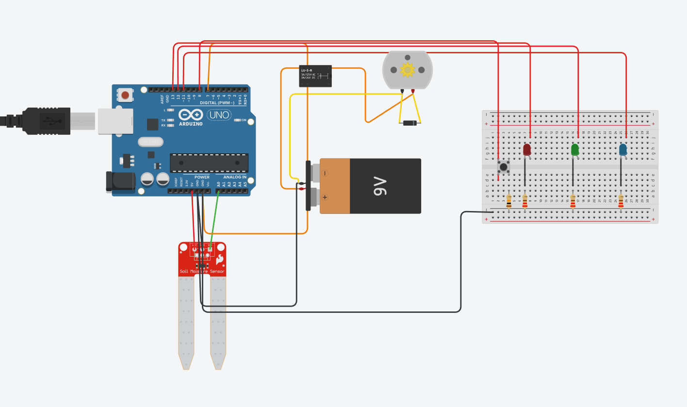

<div align="center">

# 💧 Automated Drip Irrigation System

**An Arduino controller that waters crops only when the soil needs it, cutting water use by ~25% compared with fixed-time irrigation.**


</div>

---

## 📸 Circuit

<p align="center">
  
</p>

## ✨ Features

- **Automatic watering:** a soil-moisture sensor is read every second; the pump runs while moisture is below your threshold and stops once it is reached
- **Three independent land plots:** each plot is a `struct` with its own threshold, pump state, button state and indicator LED
- **Manual override:** a push button toggles the pump on or off at any time, even in auto mode
- **Threshold history:** the last 10 thresholds for each plot are kept in a rolling buffer you can review
- **Compact state flags:** pump state and manual override are packed into a bit-field `union`
- **Serial-monitor menu:** pick a plot, then choose Manual, Auto or View History; type `r` to go back

## 🔧 Hardware

| Component | Pin | Purpose |
| --- | --- | --- |
| Soil-moisture sensor | `A0` | Reads moisture level (0–876) |
| DC motor via transistor | `D7` | Stands in for the water pump |
| Push button | `D8` (`INPUT_PULLUP`) | Manual pump override |
| LEDs × 3 | `D13`, `D12`, `D11` | Manual-mode indicator for Land 1, 2, 3 |

## ⚙️ How it works

```
Select land (1-3) ──► Select mode
                       ├─ 1. Manual  → button toggles pump, LED shows override
                       ├─ 2. Auto    → enter threshold, then every 1 s:
                       │                 moisture < threshold → pump ON
                       │                 moisture ≥ threshold → pump OFF
                       │               (button press switches to Manual)
                       └─ 3. History → list last 10 thresholds for that land
```

## 🚀 Run it

**In Tinkercad (no hardware needed)**
1. Build the circuit shown above in [Tinkercad Circuits](https://www.tinkercad.com/circuits).
2. Paste the code from [`drip_irrigation/drip_irrigation.ino`](drip_irrigation/drip_irrigation.ino) into the code editor (Text mode).
3. Start the simulation and open the Serial Monitor.

**On a real Arduino Uno**
1. Open `drip_irrigation/drip_irrigation.ino` in the Arduino IDE.
2. Wire the components as in the table above and upload.
3. Open the Serial Monitor at **9600 baud** and follow the menu.

## 📊 Result

Compared with a fixed-time watering schedule, irrigating only when the soil is below the threshold reduced water usage by approximately **25%** in simulation.

## 📄 License

[MIT](LICENSE)
